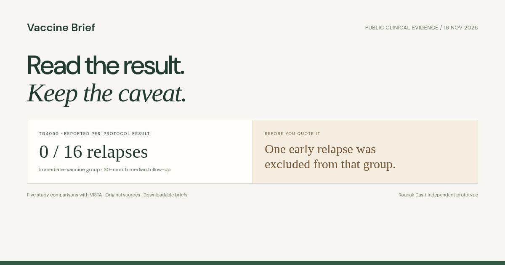

# Vaccine Brief

**Cancer-vaccine results, caveats and sources—ready for a clinical or partnering discussion.**

[Open the working tool →](https://rounakdas07.github.io/vaccine-brief/)



Pick one of five studies and compare its design with VISTA / ITOP1. Copy or download a brief that keeps the analysis population, limitations and original source URLs attached. An evidence-table CSV and a complete briefing pack are also available.

Built by **Rounak Das**, a medical student at the University of Nottingham, with AI-assisted research, design and development. Independent prototype; not commissioned, validated or endorsed by Infinitopes or any study sponsor.

## Try it in 30 seconds

1. Start with **TG4050**. Read the result and its denominator caveat together.
2. Open **Compare the study designs** to see differences from VISTA.
3. Open **Sources & review notes** to trace the claim to the relevant section.
4. Choose **Download brief**. The text file includes sources, interpretation and limits.

The other examples cover a sponsor-reported Phase 3 result, a longer-term published update, a non-randomised immune-response analysis and a historical negative trial. They are deliberately not ordered by efficacy.

## Why this exists

An important part of evaluating a cancer-vaccine programme is understanding what other trials actually support. A headline can obscure the analysis population, treatment setting or comparator. This tool packages that checking work into a short, reproducible briefing workflow.

VISTA is the reference because Infinitopes is developing ITOP1 for perioperative use in oesophageal cancer. This is a hypothesis about useful work for its clinical and partnering teams, not evidence that they lack an equivalent internal tool.

[Research rationale](docs/RESEARCH.md) · [Complete evidence pack](docs/EVIDENCE.md) · [Rounak's walkthrough](docs/WALKTHROUGH.md)

## Evidence rules

- Snapshot reviewed **18 November 2026**; no live updating or recruitment monitoring.
- Five selected comparator studies and one reference trial. This is not a systematic review, exhaustive competitor map or investment recommendation.
- Source types are labelled. A sponsor report is not silently promoted to an independently reviewed journal paper.
- Source access is disclosed. Some primary articles were reviewed through indexed abstracts or sections when direct publisher access failed.
- Facts and author appraisal appear separately. No pooled effects, cross-trial efficacy scores or predicted ITOP1 outcomes.
- Hazard ratios are not absolute risk reductions; RFS/DFS are not overall survival.
- VISTA's planned sample size is not an outcomes denominator. No identified results is not evidence of no benefit.
- The registry and sponsor descriptions of VISTA's backbone differ. A reconciliation note is preserved in every exported brief.
- Clinical review and rechecking original sources are required before professional use.

## Architecture

Buildless HTML, CSS and JavaScript modules. No packages to install, API keys, tracking, accounts, backend or local data storage. The app does not accept patient information. Sources are links to external sites; their availability and terms are independent of this project.

- `data.mjs`: curated records and source provenance
- `core.mjs`: comparisons and deterministic text/CSV exports
- `app.mjs`: accessible UI and downloads
- `tests/evidence.test.mjs`: safeguards against loss of caveats, denominators or provenance

All dynamic text uses DOM text nodes. The content security policy blocks external scripts and connections. A URL hash can select only a known study. View text opens a selectable brief for copying with the device’s normal copy command; it does not request clipboard permissions.

## Run and test

```sh
node --test tests/evidence.test.mjs
python3 -m http.server 8000
```

Open `http://localhost:8000`. ES modules require HTTP; do not double-click `index.html` as a local file. GitHub Pages serves the root of `main` with `.nojekyll`.

## Maintain the evidence

Change the structured record and its source-access note together. Confirm publication version, denominator, endpoint, follow-up and cutoff. Keep older and updated analyses distinct. Update the review date only after reviewing all records, regenerate `docs/EVIDENCE.md`, and rerun the checks. No external text is executed or used as application instructions.

## Licence

Original code: MIT. DM Sans: SIL Open Font License, included in `fonts/`. Study names and linked publications belong to their respective owners. No sponsor logos or copied publication figures are used.
