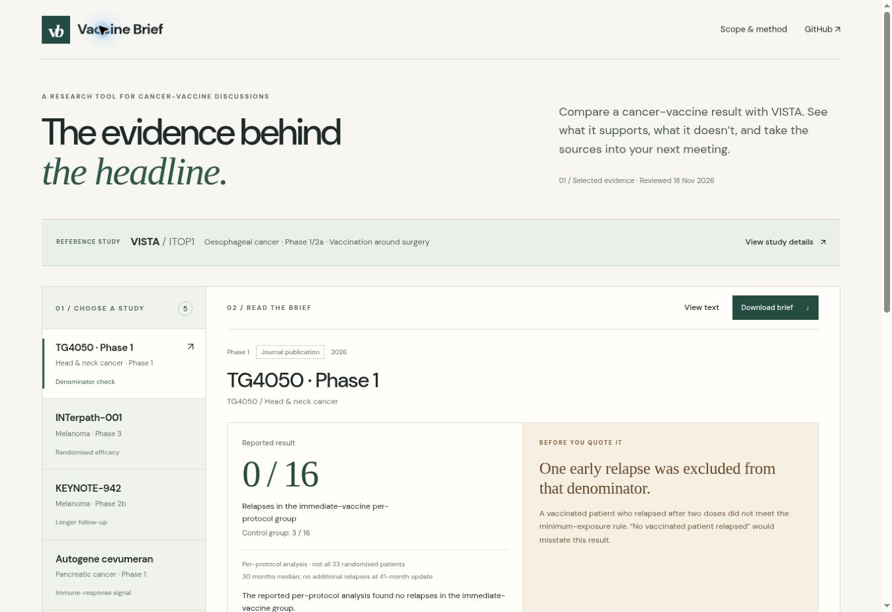

# Verification record

Checked 18 November 2026.

- All 10 Node evidence and export tests passed. These check source integrity, study denominators, retention of limitations, source URLs and CSV round trips; they do not validate clinical conclusions.
- `node --check app.mjs` passed.
- Browser study switching, source and comparison disclosures, the VISTA reference dialog and selectable brief text were exercised.
- Narrow layouts were checked at nominal widths of 390 px and 320 px. No horizontal page overflow was observed; the mobile study selector worked.
- The individual brief download was opened and checked for the denominator caveat and source URLs.
- The evidence CSV download completed and its header and record content were inspected.
- The public GitHub Pages deployment loaded successfully. Switching to MAGRIT and back worked. The complete briefing-pack download was opened: 21,007 characters including all five briefs and the scope limitation.
- The visible application contained no error state. Captured console errors came from the browser extension, not the application.

This is a manually curated research prototype, not clinical validation, exhaustive browser testing or a live evidence-monitoring service. The evidence limitations and source-access disclosures remain part of the app and its exports.

